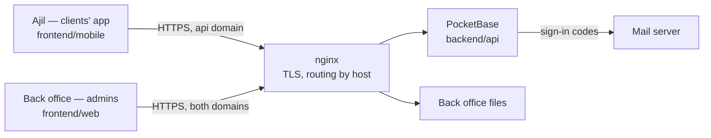
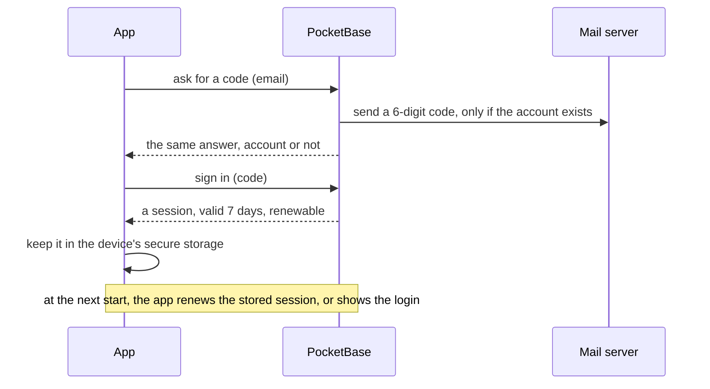
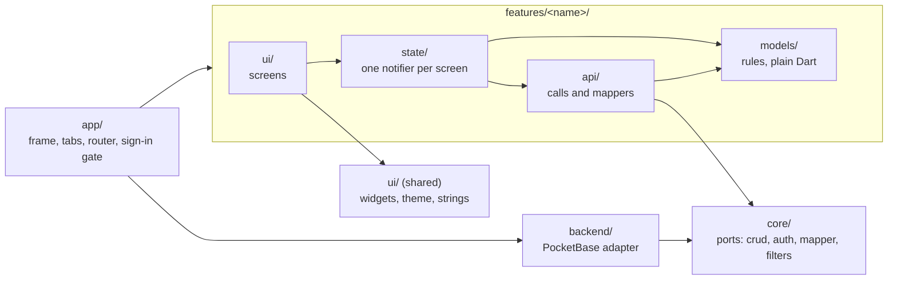

# Architecture

Two apps, one backend. The clients' app (Ajil, `frontend/mobile/`) and the back office
(`frontend/web/`, admins only) both talk to the same PocketBase. **They share no code: their only
contract is the backend's schema and rules** ([ADR 0020](adr/0020-clients-use-a-flutter-app.md)).
What the clients' app does is in [business/](business/README.md).

The deployment itself is in [the readme](../readme.md#deploy).

## Signing in

## The mobile app

`frontend/mobile/` is Flutter, on [forui](https://forui.dev)'s widgets
([ADR 0020](adr/0020-clients-use-a-flutter-app.md), [0024](adr/0024-mobile-app-uses-forui-theme.md)).
It has the web's shape, layer for layer ([ADR 0021](adr/0021-the-mobile-app-mirrors-the-web-layers.md)):

- **Only `backend/pocketbase/` knows PocketBase.** Changing backend means rewriting that folder.
- **`models/` and `api/` import no Flutter.** The rules are plain Dart.
- `dart run tool/check_architecture.dart` fails when a boundary is crossed.
- A screen not built yet has its route and says *Bientôt disponible*
  ([ADR 0023](adr/0023-unbuilt-screens-throw-at-the-api-seam.md)).
- Specs live in `test/`, mirroring `lib/` ([ADR 0022](adr/0022-mobile-specs-live-in-test.md)).

How to run and check it: [the readme](../readme.md#the-mobile-app).

## Changing the mobile app's technology

**Rewrite the screens, port the rules, keep the backend.** Nothing on the server changes, and the
back office is not touched.

### What carries over as it is

| What | Where | Why it survives |
|---|---|---|
| What the app does | [business/](business/README.md) | Written without technical terms, with each screen's status. |
| The backend and its rules | `backend/api/` | It is the contract. The back office relies on it too. |
| The wording | `frontend/mobile/lib/**/i18n/*.i18n.json` | JSON, one namespace per feature, `fr` the fallback. `(map)` keys and `{param}` are slang's syntax and need converting. |
| The screen ids | the wireframes | `A03`, `B07`… name the same screen in the design, the docs and the code. |

### What is rewritten

The screens, the navigation and the state: everything under `app/`, `ui/`, and each feature's
`ui/` and `state/`. The rules under `models/` and `api/` are plain Dart and short: port them line
by line, with their specs.

### What a client must honour

These are not visible in the screens, and the current app's specs assert them. A new client gets
them wrong unless it reproduces them.

| Rule | Today in | Asserted by |
|---|---|---|
| **An activity is read in one request with its relations expanded**: its steps with their tips and resources, its material links with the catalogue material, its workshops, its tag relations, its safety instructions. A relation that was not expanded reads as empty, never as ids. | `features/activities/api/activity_mapper.dart`, `step_mapper.dart` | `activity_mapper_test.dart` |
| **An activity's columns are flat, its model grouped by family** ([ADR 0015](adr/0015-activity-attributes-grouped-by-family.md)). Tags are one collection, read into their family by relation ([ADR 0014](adr/0014-activity-tags-are-one-collection.md)). | `activity_mapper.dart` | `activity_mapper_test.dart` |
| **A file is stored as a name**; its url is built from the record. | `core/files/file_url_resolver.dart` | `activity_mapper_test.dart` |
| **A choice is stored in CONSTANT_CASE**; an empty one is unset, and a value this version does not know reads as unset. | `core/data/mapper.dart` | `activity_mapper_test.dart` |
| **A range bound of 0 is unset**, on an activity and on the user's defaults; an unset bound is written as 0. | `activity_mapper.dart`, `features/user/api/filter_defaults_mapper.dart` | `activity_mapper_test.dart`, `user_test.dart` |
| **The catalogue filter**: a range keeps an activity whose range overlaps, an unset upper bound being no limit; a multiple choice is compared value by value (`:each`), any one being enough. | `activity_mapper.dart`, `models/catalogue_filters.dart` | `activity_mapper_test.dart`, `catalogue_filters_test.dart` |
| **A favourite is added or removed one at a time** (`favorites+`, `favorites-`), never by writing the list. Two writes in flight must not cancel each other. | `features/activities/api/activities_api.dart` | `favorites_test.dart` |
| **One feedback per user and activity**, under a unique index: update it when it exists; a second tap while saving creates nothing. | `state/feedback.dart`, `models/feedback.dart` | `feedback_test.dart` |
| **Pages are appended**; a new search starts over and drops a page that answers the previous one. | `state/catalogue.dart` | `library_feed_test.dart` |
| **The router waits for the session**, sends nobody signed in to the login, a user not onboarded to the onboarding (`onboarded` on the user), and a signed-in user away from the login. | `features/user/guard.dart` | `user_test.dart` |
| **The session is kept in the device's secure storage**, not in plain preferences. | `backend/pocketbase/client.dart` | — |

Paths are under `frontend/mobile/lib/` and `frontend/mobile/test/features/`.

### What the design asks of the platform

To weigh a technology against. Each line points to the screens that need it.

- **Phones, and a link opened in a browser.** Store apps for iOS and Android; and "code or link →
  catalogue → sheet → guided mode, with no account" as the first priority
  ([business](business/README.md#not-decided)). A link has to open the right screen.
- **Navigation**: five tabs each keeping its history, full-screen pages over them, panels from the
  bottom, immersive modes, the phone's back button behaving as the arrow
  ([the frame](business/README.md#the-frame)).
- **A secure session on the device** ([signing in](business/account.md#signing-in)).
- **Rich lists and inputs**: blocks reordered by dragging (B08, B18), a calendar by day, week,
  month and year (B01), a time grid across units (B14), bars of a breakdown (C05).
- **PDF export and printing** of a chosen folder, with a preview (A11, A12).
- **Notifications** that open the right screen (E08, E10).
- **Light and dark themes, French and English, fewer animations on request** (E03).

Not in the design, but worth weighing: the guided mode is used during the activity, often
outdoors, where the network may be poor.

### Doing it

1. Write an ADR that replaces [0020](adr/0020-clients-use-a-flutter-app.md), and
   [0021](adr/0021-the-mobile-app-mirrors-the-web-layers.md) to
   [0024](adr/0024-mobile-app-uses-forui-theme.md) where they no longer hold.
2. Build the new app beside `frontend/mobile/`, against the same backend.
3. Port the built screens first, in the order a user meets them: signing in and the onboarding,
   the catalogue, the sheet, the guided mode, *Mon espace*. Port each rule above with its spec.
4. Copy the wording over.
5. Delete `frontend/mobile/` once the new app covers the same screens, and update the readme,
   `CLAUDE.md` and this file.
